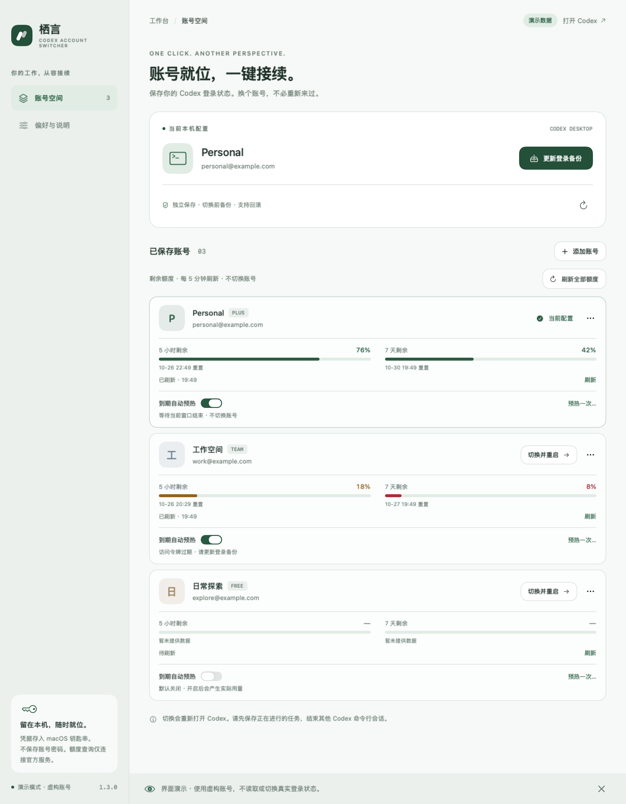
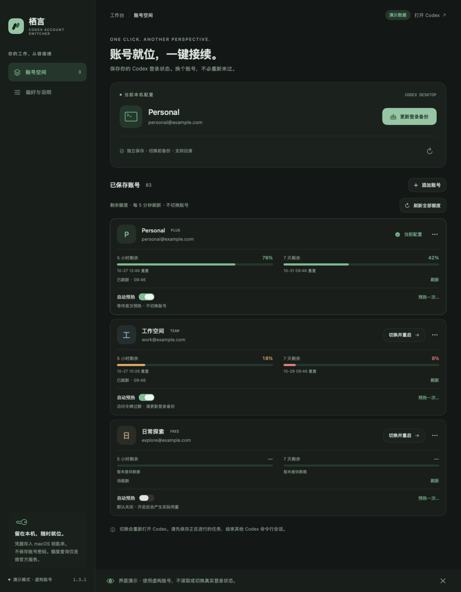

<h1 align="center">Still · Codex Account Switcher</h1>

<p align="center">Your accounts, ready when you are.</p>

<p align="center">A native account manager for Codex Desktop on macOS and Windows.</p>

<p align="center">
  <a href="./README.md">English</a> · <a href="./README.zh-CN.md">简体中文</a> ·
  <a href="https://github.com/245678000000/still-codex-switcher/releases">Downloads</a>
</p>

## Overview

Still (栖言) saves multiple ChatGPT sign-ins locally and helps you move between them in the **official Codex desktop app**. Check account quotas, review local token usage, and switch with a confirmed restart.

This is an account-management companion—not a web-chat wrapper, a separate chat client, or an API-key manager. The current application interface is in Simplified Chinese.

## Highlights

| Feature | What you get |
| --- | --- |
| Multiple accounts | Save the current login, add other accounts through the official sign-in flow, and organize them with names and search. |
| Quotas at a glance | Per-account 5-hour and 7-day remaining usage, reset times, and clearly marked stale or missing results. |
| Local token statistics | Date filters, input/output breakdowns, daily trends, model distribution, and CSV export. |
| Reset credits | Available credits, expiration dates, and a confirmation before using one. Pending requests retain their identifier to reduce duplicate consumption. |
| Optional warm-up | Per-account controls and a manual action. Disabled by default; each request consumes real model usage. |
| Native desktop UI | SwiftUI on macOS and WPF on Windows, with light, dark, and system appearance. |

**macOS 1.7.1 also includes** login-health badges, explicit Keychain unlock, priority verification after re-login, encrypted account import/export, switch-progress indicators, and update checks.

The platforms have separate release tracks. macOS-specific features are not automatically available in the Windows build.

## Download

| Platform | Requirements | Current preview | Package |
| --- | --- | --- | --- |
| macOS | Apple Silicon (M series), macOS 14+ | [1.7.1-preview.1](https://github.com/245678000000/still-codex-switcher/releases/tag/macos-v1.7.1-preview.1) | [macOS ZIP](https://github.com/245678000000/still-codex-switcher/releases/download/macos-v1.7.1-preview.1/Codex-Account-Switcher-macOS.zip) |
| Windows | Windows 10/11, Intel/AMD x64 | [1.5.0-preview.1](https://github.com/245678000000/still-codex-switcher/releases/tag/windows-v1.5.0-preview.1) | [Windows ZIP](https://github.com/245678000000/still-codex-switcher/releases/download/windows-v1.5.0-preview.1/Codex-Account-Switcher-Windows-x64.zip) |

Install the official Codex desktop app first. Still uses its bundled CLI for sign-in and account queries.

- **macOS:** quit the previous Still version, extract the ZIP, and move `栖言 Codex 账号.app` to Applications.
- **Windows:** extract the entire ZIP to a local folder, run `self-test.cmd`, then launch `StillCodexSwitcher.exe`. The release is self-contained; a separate .NET runtime is not required.
- **Signing:** the Mac preview is ad-hoc signed, without Developer ID notarization; the Windows preview has no Authenticode publisher signature. Follow your OS's application-review prompts and verify the download source.

## Quick Start

1. Open Codex and sign in to the account you want to save.
2. Launch Still and select **保存当前账号** (Save current account), or **更新登录备份** (Update login backup) for an existing entry.
3. Select **添加账号** (Add account) to sign in to another account on the official OpenAI page. Your current Codex login stays in place during this step.
4. Save your work and finish other Codex sessions sharing the same login directory.
5. Select **切换并重启** (Switch and restart), confirm, and check the selected account in Codex after it reopens.

**Switching requires a restart; it is not a hot swap inside a running Codex window.** Tools using the same `CODEX_HOME`—including a CLI or editor extension—also share that login file. This release does not guarantee isolation from those tools.

For expired entries on macOS, use **重新登录** (Sign in again). A newly saved login is verified first; if Codex still holds the older copy, use **载入新登录** (Load new login) when you are ready to restart it.

## Preview

| Light | Dark |
| --- | --- |
|  |  |

These are macOS demo screenshots from an earlier preview, using fictional accounts and quotas. Controls may differ in the current release.

## Credentials, Privacy, and Limits

### Local storage

- **macOS:** saved credentials and rollback backups are AES-GCM encrypted under `~/Library/Application Support/StillCodexSwitcher/vault/`; the encryption key is held in macOS Keychain.
- **Windows:** credentials and rollback backups use DPAPI scoped to the current Windows user, under `%LOCALAPPDATA%\StillCodexSwitcher\vault`.
- The account list contains display metadata such as names, email addresses, and cached plan labels—not login tokens. Account passwords are not collected.
- The active login remains in `$CODEX_HOME/auth.json` (`%CODEX_HOME%\auth.json` on Windows), defaulting to `~/.codex/auth.json` or `%USERPROFILE%\.codex\auth.json`.
- Sign-in and quota queries contact official services; Mac update checks contact GitHub. Local token-log scanning itself is offline.
- Migration from older Mac versions is verified before legacy entries are removed. Existing Keychain permissions are preserved; deleting the encryption key makes saved encrypted files inaccessible. See [credential details](docs/credentials.md).

### Login validity and renewal

**Refreshing quotas is not the same as renewing OAuth credentials.** Still 1.7.1 does not automatically renew every saved, inactive account. On macOS, it monitors the current Codex login and can save credentials that Codex has renewed.

An “authentication valid” badge reflects acceptance of that credential copy during a service check; it is not a promise of future renewal. Exporting a login copies the same session rather than creating a new one. If multiple applications or devices renew that copy independently, token rotation can leave another copy stale. Sign in separately for long-term use on different devices.

### Usage and account boundaries

- Local token statistics cover identifiable desktop main sessions—not a complete account bill. Other devices, CLI/editor sessions, derived sessions, and temporary warm-up requests are excluded; historical usage is not assigned to the currently selected account.
- Warm-up sends real model requests. It does not add quota or guarantee a reset. Automatic warm-up pauses on failure or an uncertain result.
- Reset credits follow the official account's eligibility and rules. A confirmation is required; stale or missing data is not displayed as a full balance.
- ChatGPT sign-in with file-based credential storage is supported. API-key, keyring, auto, and ephemeral configurations are not switched by this release.
- Chat history and project files stay in place. Accounts, subscriptions, and quota balances are not merged.

## Build and Test

### macOS

Requirements: Xcode Command Line Tools, Python 3, and a supported Mac. No third-party Swift packages are required.

```bash
git clone https://github.com/245678000000/still-codex-switcher.git
cd still-codex-switcher
bash scripts/build.sh /private/tmp/still-switcher-dist
```

The script compiles the app, signs it, runs fixture tests, and writes `Codex-Account-Switcher-macOS.zip`. Developers with a signing identity can set `CODE_SIGN_IDENTITY`; the default is ad-hoc signing.

After installing the app, these commands use fictional accounts:

```bash
"/Applications/栖言 Codex 账号.app/Contents/MacOS/StillCodexSwitcher" --demo
"/Applications/栖言 Codex 账号.app/Contents/MacOS/StillCodexSwitcher" --self-test
```

### Windows

Requirements: Windows and the .NET 8 SDK. From the repository root:

```powershell
cd windows
./scripts/build.ps1
```

The script runs core tests and publishes a self-contained build. The manual [Windows fixture workflow](.github/workflows/windows.yml) covers Windows-native checks and demo renders. See the [Windows guide](windows/README.md) for troubleshooting and build details.

## Documentation

Most detailed guides are currently in Simplified Chinese.

| Topic | Guide |
| --- | --- |
| macOS login state, re-login, and encrypted transfers | [Credentials](docs/credentials.md) |
| Quota display and stale-data behavior | [macOS quotas](docs/macos-quota.md) |
| Local token statistics and exclusions | [macOS statistics](docs/macos-token-statistics.md) · [Windows statistics](windows/docs/token-statistics.md) |
| Optional warm-up and usage implications | [macOS warm-up](docs/macos-window-warmup.md) · [Windows warm-up](windows/docs/auto-warmup.md) |
| Reset-credit confirmation and pending requests | [Reset credits](docs/reset-cards.md) |
| Read-only account diagnostics | [Diagnostics](docs/account-diagnostics.md) |
| Mac update channels and checks | [Updates](docs/macos-updates.md) |
| Windows installation and troubleshooting | [Windows guide](windows/README.md) |
| macOS 1.7.1 validation scope | [Validation record](docs/macos-ux-validation.md) |

## Project Status and Feedback

Both downloads are **previews**. The macOS 1.7.1 release passed **442 offline fixture tests** plus signing, archive, and demo-render checks. Those tests do not establish a complete real-account sign-in, switching, or renewal workflow; real-account behavior depends on the installed Codex version and service responses.

For a bug report, include the OS version, Still version, Codex version, reproduction steps, and a redacted error message. Never attach `auth.json`, vault files, passwords, full OAuth URLs, or unredacted account exports. Use [GitHub Issues](https://github.com/245678000000/still-codex-switcher/issues) for feedback.

## Acknowledgments and Community

Inspired by codexm. The macOS app is a native SwiftUI implementation; this repository does not include, run, or distribute codexm source or prebuilt executables.

Thanks to the [LINUX DO](https://linux.do/) community for discussion and feedback.

Still is an independent third-party project, not affiliated with or endorsed by OpenAI.

## License

[MIT](LICENSE)
