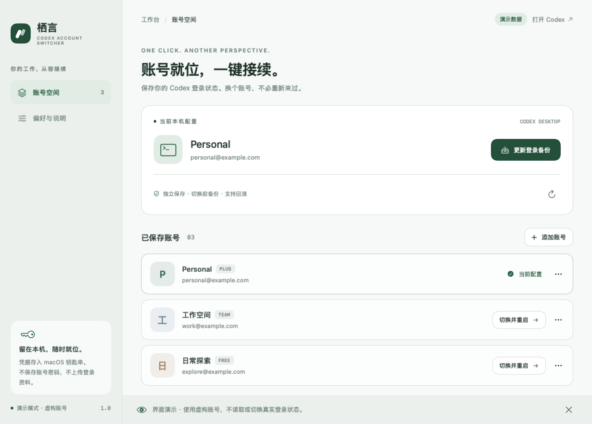
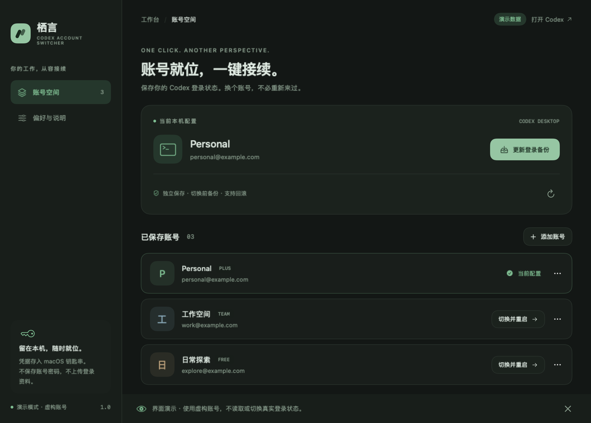

# 栖言 · Codex 账号

> Still — a native macOS account switcher for the Codex desktop app. Save multiple ChatGPT logins locally (Keychain) and switch with one click.

一个独立的 macOS 账号切换器，切换的是原来的 **Codex 桌面端**，不是网页聊天窗口，也不是 API 聊天客户端。

**平台：Apple Silicon（M 系列），macOS 14 或更新版本。**

Windows 10/11 x64 安装包是 [Releases](https://github.com/245678000000/still-codex-switcher/releases/latest) 里的 `Codex-Account-Switcher-Windows-x64.zip`。源码和说明在 [`windows/`](windows/README.md)。Mac 钥匙串和 Windows 加密库不互通，需要在各自系统上登录一次。

| 浅色 | 深色 |
|---|---|
|  |  |

<sub>截图为 `--demo` 演示模式，账号均为虚构。</sub>

## 第一次使用

1. 按下方「源码与构建」编译，或从 [Releases](https://github.com/245678000000/still-codex-switcher/releases/latest) 下载 `Codex-Account-Switcher-macOS.zip` 并解压，把「栖言 Codex 账号.app」拖到「应用程序」。
2. 打开栖言，点击 **保存当前账号**。已有的 Codex 登录会话会保存到本机钥匙串；不需要向栖言输入密码。
3. 点击 **添加账号**，在浏览器的 OpenAI 官方页面登录另一个账号。如果浏览器仍使用原账号，请在登录页面选择要添加的账号。同一账号重复添加会更新原记录。
4. 需要切换时，先保存 Codex 正在进行的工作，并结束其他共享登录的 Codex 命令行会话。
5. 点击账号右侧的 **切换并重启**，确认后等待 Codex 重新打开，在 Codex 的头像菜单中核对账号。

这是“点选账号后重启生效”，不是在仍运行的 Codex 窗口中即时热切换。

## 功能

- 保存当前账号；独立添加其他账号，不先退出当前 Codex。
- 账号列表、备注修改、搜索（超过三个账号时显示）、移除保存记录。
- 浅色、深色、跟随系统；原生 SwiftUI 界面；响应系统减少动态效果偏好。
- 菜单栏快速选择账号；每次切换仍先确认，避免中断任务。
- 关闭窗口后常驻菜单栏；Command-Q 完全退出。
- Command-S 保存当前账号，Command-N 添加账号。
- 切换前更新当前账号的最新凭据，避免使用过旧的刷新令牌。
- 自动备份与原子写入；启动失败时恢复原来的文件（若检测到其他程序又修改了文件则保留其改动）。
- 「偏好与说明」中可恢复上一次切换前的账号。

## 数据与兼容性

- 保存的会话凭据、独立回滚备份：macOS 钥匙串服务 `app.local.still.codex-switcher.credentials`；不启用 iCloud 同步。
- 账号备注、邮箱、订阅缓存标签：本机 `~/Library/Application Support/StillCodexSwitcher/accounts.json`，权限 0600。
- 使用中的登录文件：`$CODEX_HOME/auth.json`；没有设置环境变量时使用 `~/.codex/auth.json`。替换文件权限为 0600。
- 添加账号使用**已安装 Codex 自带的官方 CLI**。它在单独的 0700 私有目录中暂存登录资料，完成或取消后清理；下次添加时也会清理本工具遗留的 UUID 登录暂存目录。
- 不上传凭据到第三方服务，不收集密码，不改 Codex 配置、聊天记录、项目文件或安装程序。
- 仅适配通过 ChatGPT 登录并采用 `file` 存储的凭据。显式 `keyring`、`auto`、`ephemeral` 或 API Key 情况会提示并保留现状，不自动更改存储模式。
- 本机 JWT 中的邮箱与订阅标签仅用于展示，没有把它们当成服务器登录验证。额度、订阅和实际身份以 Codex 为准。
- 登录可能过期或被撤销，需要再次添加账号；不承诺永久免登录。
- 切换共享 CODEX_HOME 的登录文件也影响使用该目录的 CLI/扩展。请避免多个账号管理工具同时操作。
- 保存不同账号不会合并订阅、额度或云端数据。
- 移除账号只删除切换器的保存记录；当前 Codex 登录和独立回滚备份仍然保留。删除 App 本身也不会自动移除钥匙串记录。

### 当前验证版本

本机识别到的目标应用安装文件名是 `ChatGPT.app`，Bundle ID 为 `com.openai.codex`，版本 `26.1013.40934`。登录组件版本 `codex-cli 0.163.0-alpha.10.2`。工具通过 Bundle ID 找到正在运行或已安装的 Codex，并不把安装文件名写死。

### 安装提示

这个本地构建使用 ad-hoc 签名，已做签名完整性校验；没有 Apple Developer ID 公证。若 macOS 提示来源尚未验证，请按系统提供的应用审阅/打开流程处理，或从源码自行编译。没有关闭 Gatekeeper 或修改系统安全设置。首次访问钥匙串时如出现系统提示，请核对应用名称。

## 测试结果与尚待验证

详见 `Tests/验收记录.md`。

- 48 项本地测试通过，包括真实钥匙串的**独立测试服务**存取与删除；所有凭据均为虚构测试数据。
- 已对本机官方 CLI 验证初始化、空账号读取、发起 OAuth、取消 OAuth；没有打开登录页面，也没有替换当前 Codex 账号。
- 已编译、签名、打包，并从 ZIP 重新解压验证。
- 已渲染并检查浅色、深色、空列表与设置页。
- 原生 UI 自动化访问未获批准，因此不把按钮交互与菜单栏操作标记为已验收。
- **未完成真实账号的浏览器登录回调和完整“退出 → 换账号 → 重启 → 核对头像”验证。** 目前交付为可运行的首版，首次切换前务必保存任务。

## 源码与构建

无第三方 Swift 依赖。需要 Xcode Command Line Tools 和 Python 3。

```sh
bash scripts/build.sh /private/tmp/still-switcher-dist
```

脚本把源码字节复制到临时目录编译，避免云同步目录的扩展属性污染签名；运行核心测试后生成 ZIP。默认编译本机架构，可通过 `ARCH=arm64` 指定。当前交付和验收针对 Apple Silicon。

开发命令（以解压后的 App 路径替换 `APP`）：

```sh
"$APP/Contents/MacOS/StillCodexSwitcher" --self-test
"$APP/Contents/MacOS/StillCodexSwitcher" --self-test --keychain-test
"$APP/Contents/MacOS/StillCodexSwitcher" --demo
"$APP/Contents/MacOS/StillCodexSwitcher" --render /private/tmp/preview.png --dark
```

`--demo` 和 `--render` 使用虚构账号，不读取真实 auth.json，不切换 Codex。`--keychain-test` 只使用随机命名的本工具测试服务，测试结束删除测试项目。

## Windows

下载 [Codex-Account-Switcher-Windows-x64.zip](https://github.com/245678000000/still-codex-switcher/releases/latest)。源码在 [`windows/`](windows/README.md)。在 Windows 上安装 .NET 8 SDK 后，进入该目录运行 `./scripts/build.ps1`。核心逻辑 75 项模拟测试已记录通过；原生窗口、DPAPI 和真实账号切换尚待 Windows 实机验收。手动验收工作流是 `.github/workflows/windows.yml`。

## 致谢

思路受 codexm 启发。本项目是原生 SwiftUI 的重新实现，切换逻辑全部在本仓库源码中，不包含、不运行也不分发 codexm 的代码或预编译可执行文件。

## 许可证

[MIT](LICENSE)

## 官方机制参考

- [Codex 身份验证与登录缓存](https://developers.openai.com/codex/auth)
- [Codex app-server 登录协议](https://developers.openai.com/codex/app-server)

这是独立第三方本地工具，与 OpenAI 无官方关联。后续 Codex 登录存储或启动协议变化时，可能需要适配。
