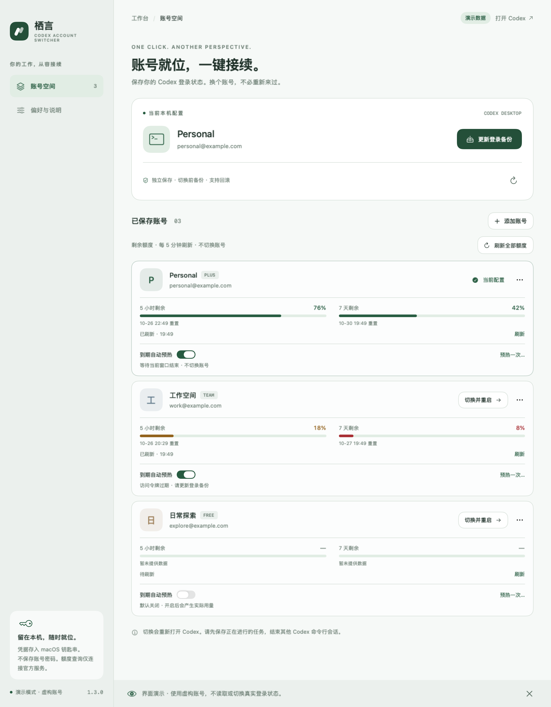
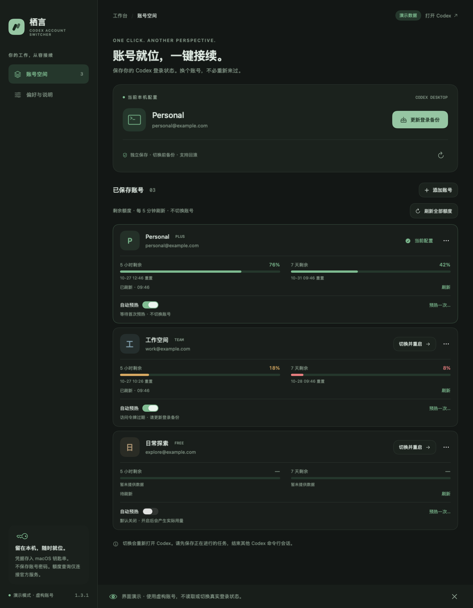

<h1 align="center">栖言 · Codex 账号切换器</h1>

<p align="center">账号就位，一键接续。</p>

<p align="center">面向 macOS 与 Windows 的原生 Codex 桌面端账号管理工具。</p>

<p align="center">
  <a href="./README.md">English</a> · <a href="./README.zh-CN.md">简体中文</a> ·
  <a href="https://github.com/245678000000/still-codex-switcher/releases">下载版本</a>
</p>

## 项目介绍

栖言（Still）把多个 ChatGPT 登录保存在本机，帮助你在 **官方 Codex 桌面端**之间切换账号。先看额度、查看本地 Token 用量，再确认切换并重启 Codex。

它是账号管理助手，不是网页聊天壳、独立聊天客户端或 API Key 管理器。当前应用界面为简体中文。

## 核心功能

| 功能 | 解决什么问题 |
| --- | --- |
| 多账号管理 | 保存当前登录，通过官方流程添加账号，支持备注与搜索。 |
| 额度一眼可见 | 每个账号的 5 小时、7 天剩余额度及重置时间；过期结果和缺失数据明确标注。 |
| 本地 Token 统计 | 按日期筛选输入、输出等用量，查看每日趋势与模型分布，导出 CSV。 |
| 重置卡入口 | 显示张数和有效期，确认后使用；结果待确认时保留原请求标识，减少重复消耗风险。 |
| 可选账号预热 | 每个账号独立开关，也支持手动执行。默认关闭，执行会产生真实模型用量。 |
| 原生桌面体验 | macOS 使用 SwiftUI，Windows 使用 WPF，支持浅色、深色和跟随系统。 |

**macOS 1.7.1 另含：** 登录状态徽标、手动解锁钥匙串、重新登录后优先验证、加密导入导出、切换进度与更新检查。

两端独立发布；Mac 新增功能不代表 Windows 已同步支持。

## 下载与安装

| 平台 | 系统要求 | 当前预览版 | 安装包 |
| --- | --- | --- | --- |
| macOS | Apple Silicon（M 系列），macOS 14+ | [1.7.1-preview.1](https://github.com/245678000000/still-codex-switcher/releases/tag/macos-v1.7.1-preview.1) | [macOS ZIP](https://github.com/245678000000/still-codex-switcher/releases/download/macos-v1.7.1-preview.1/Codex-Account-Switcher-macOS.zip) |
| Windows | Windows 10/11，Intel/AMD x64 | [1.5.0-preview.1](https://github.com/245678000000/still-codex-switcher/releases/tag/windows-v1.5.0-preview.1) | [Windows ZIP](https://github.com/245678000000/still-codex-switcher/releases/download/windows-v1.5.0-preview.1/Codex-Account-Switcher-Windows-x64.zip) |

请先安装官方 Codex 桌面端。栖言使用其自带 CLI 完成登录与账号查询。

- **macOS：** 先退出旧版栖言，解压 ZIP，把 `栖言 Codex 账号.app` 放入「应用程序」。
- **Windows：** 完整解压 ZIP 到本机文件夹，先运行 `self-test.cmd`，再启动 `StillCodexSwitcher.exe`。发布包自包含运行库，无需单独安装 .NET。
- **签名说明：** Mac 预览包采用 ad-hoc 签名，未做 Developer ID 公证；Windows 预览包暂无 Authenticode 发布者签名。请核对下载来源，按操作系统提供的应用审阅流程处理提示。

## 快速上手

1. 打开 Codex，登录你要保存的账号。
2. 启动栖言，点击 **保存当前账号**；已有记录时使用 **更新登录备份**。
3. 点击 **添加账号**，在 OpenAI 官方网页登录另一个账号。添加过程中，当前 Codex 登录保持原样。
4. 保存工作，结束其他共享登录目录的 Codex 会话。
5. 点击目标账号的 **切换并重启**，确认后等待 Codex 打开，再到头像菜单核对账号。

**切换需要重启，不是在运行中的 Codex 窗口内热切换。** 使用同一 `CODEX_HOME` 的 CLI、编辑器扩展也共用该登录文件；当前版本不保证与这些工具相互隔离。

Mac 账号过期时，可点 **重新登录**。新登录保存后会优先验证；如果 Codex 仍持有旧副本，准备好重启时再点 **载入新登录**。

## 界面预览

| 浅色 | 深色 |
| --- | --- |
|  |  |

以上为早期 Mac 预览版的演示截图，账号与额度均为虚构；当前版本的控件可能有所不同。

## 凭据、隐私与使用边界

### 本机保存

- **macOS：** 凭据和回滚备份通过 AES-GCM 加密，存放在 `~/Library/Application Support/StillCodexSwitcher/vault/`；密钥由 macOS 钥匙串保管。
- **Windows：** 使用当前 Windows 用户作用域的 DPAPI 加密，目录为 `%LOCALAPPDATA%\StillCodexSwitcher\vault`。
- 账号列表只记录备注、邮箱、缓存的订阅标签等展示信息，不含登录令牌；栖言不收集账号密码。
- 正在使用的登录文件仍是 `$CODEX_HOME/auth.json`，Windows 对应 `%CODEX_HOME%\auth.json`；默认位置分别为 `~/.codex/auth.json` 和 `%USERPROFILE%\.codex\auth.json`。
- 登录与额度查询连接官方服务，Mac 更新检查连接 GitHub；Token 日志统计本身离线完成。
- 旧版 Mac 凭据迁移通过校验后才清理旧条目。已有钥匙串访问权限保持原样；请勿删除保管密钥的条目，以免丢失解密能力。详见[凭据说明](docs/credentials.md)。

### 登录有效期与续期

**刷新额度，不等于刷新登录凭据。** 栖言 1.7.1 暂未对全部闲置账号自动续期。Mac 版会监听当前 Codex 登录变化，并保存 Codex 已续期的凭据。

「认证有效」表示查询时官方服务接受了这一份凭据，不承诺后续续期持续成功。导出得到的是同一份登录会话，不是新会话；多个应用或设备分别续期同一副本时，令牌轮换可能使其他副本过旧。长期多设备使用，建议分别登录。

### 用量与账号边界

- Token 统计只覆盖来源明确的本机桌面主会话，不是完整账户账单。其他设备、CLI、编辑器插件、派生会话和临时预热请求不在统计范围内；历史用量也不直接归给当前账号。
- 预热会发送真实模型请求，不补充额度，也不保证重置窗口。自动预热失败或结果不明时暂停。
- 重置卡的资格与作用以官方规则为准；使用前需要确认，缺失或过旧的数据不显示为满额。
- 当前支持 ChatGPT 登录及文件型凭据存储；API Key、keyring、auto、ephemeral 配置不在本版切换范围内。
- 聊天记录与项目文件保持原样；各账号的订阅、额度和云端数据不会合并。

## 源码构建与测试

### macOS

需要 Xcode Command Line Tools、Python 3 及受支持的 Mac，无第三方 Swift 包依赖。

```bash
git clone https://github.com/245678000000/still-codex-switcher.git
cd still-codex-switcher
bash scripts/build.sh /private/tmp/still-switcher-dist
```

构建脚本完成编译、签名及虚构数据测试，输出 `Codex-Account-Switcher-macOS.zip`。开发者可通过 `CODE_SIGN_IDENTITY` 指定签名身份，默认使用 ad-hoc 签名。

安装后，可用以下命令查看虚构账号演示或运行离线自测：

```bash
"/Applications/栖言 Codex 账号.app/Contents/MacOS/StillCodexSwitcher" --demo
"/Applications/栖言 Codex 账号.app/Contents/MacOS/StillCodexSwitcher" --self-test
```

### Windows

需要 Windows 和 .NET 8 SDK。在仓库根目录执行：

```powershell
cd windows
./scripts/build.ps1
```

脚本先运行核心测试，再生成自包含发布包。[Windows 手动验收工作流](.github/workflows/windows.yml)覆盖原生检查与演示渲染。排障及详细构建步骤见 [Windows 说明](windows/README.md)。

## 详细文档

现有详细文档主要为简体中文。

| 主题 | 文档 |
| --- | --- |
| Mac 登录状态、重新登录与加密迁移 | [凭据管理](docs/credentials.md) |
| 额度显示与过旧数据的处理 | [Mac 额度](docs/macos-quota.md) |
| Token 数据口径与排除项 | [Mac 统计](docs/macos-token-statistics.md) · [Windows 统计](windows/docs/token-statistics.md) |
| 账号预热与真实用量说明 | [Mac 预热](docs/macos-window-warmup.md) · [Windows 预热](windows/docs/auto-warmup.md) |
| 重置卡确认与请求核对 | [重置卡](docs/reset-cards.md) |
| 只读账号基础诊断 | [账号诊断](docs/account-diagnostics.md) |
| Mac 更新检查与预览渠道 | [更新说明](docs/macos-updates.md) |
| Windows 安装与排障 | [Windows 说明](windows/README.md) |
| macOS 1.7.1 验收范围 | [交互验收](docs/macos-ux-validation.md) |

## 项目状态与反馈

两端均为 **预览版**。macOS 1.7.1 发布前通过 **442 项离线测试**，以及签名、压缩包和演示渲染检查。这些测试不代表真实账号登录、切换与续期的完整流程已经验收；实际表现还取决于所安装的 Codex 版本及官方服务返回。

反馈问题时，请提供操作系统、栖言和 Codex 版本、复现步骤及脱敏错误信息。请勿附上 `auth.json`、vault 文件、密码、完整 OAuth 链接或未脱敏账号导出。问题反馈入口：[GitHub Issues](https://github.com/245678000000/still-codex-switcher/issues)。

## 致谢与社区

思路受 codexm 启发。Mac 版使用原生 SwiftUI 重新实现；本仓库没有包含、运行或分发 codexm 的源码或预编译程序。

感谢 [LINUX DO](https://linux.do/) 社区的交流与反馈。

本项目为独立第三方工具，与 OpenAI 无官方关联。

## 许可证

[MIT](LICENSE)
