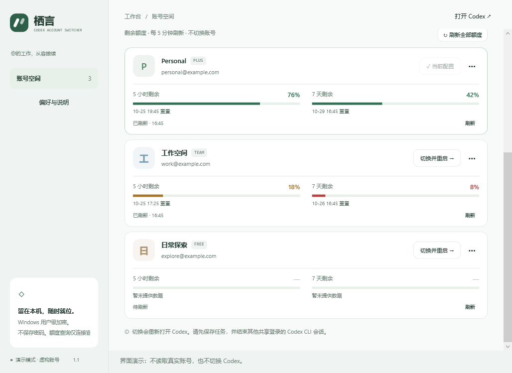
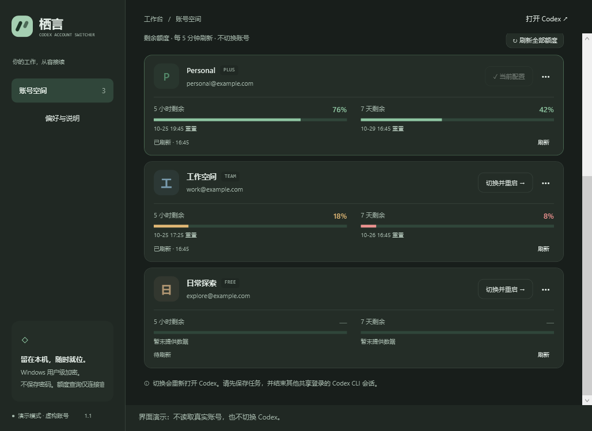

# 栖言 · Codex 账号 / Windows 版

**独立的 Codex 桌面账号切换器。** 保存当前账号、添加其他账号，选中后确认切换并重新打开 Codex。不是网页聊天壳，不使用 API Key 代替账号登录。

## 当前交付状态

- 下载：[Codex-Account-Switcher-Windows-x64.zip](https://github.com/245678000000/still-codex-switcher/releases/tag/windows-v1.5.0-preview.1)。
- Windows x64 自包含 EXE，适用于 Windows 10/11 的 Intel / AMD 64 位电脑；无需单独安装 .NET，无需管理员权限。
- 已在 Mac 上交叉编译生成真正的 Windows PE32+ GUI 可执行文件；使用 Microsoft .NET 8.0.32 运行库。
- 核心逻辑与子进程离线用例覆盖 Token、额度、自动预热、防重与取消清理；Windows DPAPI/ACL 原生检查与浅色、深色、小窗口、空状态 WPF 渲染由 GitHub Windows runner 验收，结果见发布页。官方登录回调、真实账号额度查询及重启切换仍待登录后核对。
- 这是便携预览版，不把模拟账号的构建与自检等同于真实账号全流程验收。测试未读取或更改你的真实 Codex 登录。
- 没有配置 Authenticode 发布者签名，Windows 可能显示来源提示。本程序不会修改 Defender、SmartScreen、执行策略等系统保护设置。

## Windows 1.5：重置卡

额度下方小字展示张数、到期时间与「使用一张…」；使用前确认账号，超时保留同一请求标识，防重复扣卡。未知数量、过期或陈旧信息先刷新。详情见 [重置卡说明](../docs/reset-cards.md)。原有基础诊断、自动预热、Token 统计和账号切换保留。

## Windows 1.3.1：侧栏排版修复

账号空间、Token 统计、偏好与说明统一左对齐，账号数量保持右对齐；浅色、深色和小窗口布局一致。自动预热、Token 统计与账号库行为保持原样。

## Windows 1.3：自动预热

每个账号卡片新增「自动预热」开关和「预热一次…」。默认关闭；开启前逐账号确认。首次检查尝试最小消息，此后至少间隔 5 小时，并参考官方重置时间；最小化后继续检查，关闭窗口或退出后停止。失败、令牌过期或结果不明时暂停。

预热会产生真实用量，使用 GPT-6 Luna / low；5 小时须有余额，7 天须剩余至少 1%。不切换当前账号，不退出 Codex，不触碰 VS Code 登录文件，不传刷新令牌或回写凭据。手动操作不再被未来重置时间挡住，窗口效果以官方为准。

详细行为、暂停恢复和测试边界见 [自动预热说明](docs/auto-warmup.md)。测试全程使用虚构账号；尚未在用户真实 Windows 账号上发送消息。

## Windows 1.2：Token 消费统计

左侧新增「Token 统计」：今日、近 7 天、近 30 天、全部；输入、缓存输入、输出、推理 Token；每日趋势、模型分布、悬停明细和 CSV 导出。后台只读本机日志，按累计增量去重，文件未变化时复用内存缓存；本页可见时每分钟刷新。

这是**本机部分桌面主会话记录**，不是官方账单或剩余额度。VS Code 插件、独立 CLI、分叉/子代理、WSL、其他设备和临时预热不计入；历史会话可能跨账号，暂不按账号拆分。统计不启动模型请求，不触碰登录凭据。详细口径见 [统计说明](docs/token-statistics.md)。

升级方法：退出旧切换器，将新 ZIP 完整解压到新目录，运行新版 EXE。原有账号库位于 LocalAppData，继续沿用；不复制或删除账号凭据。保留旧文件夹可回退。Mac 包与 Windows 包分别下载。

现有账号切换行为保持原状；1.3 已加入自动预热，但尚未加入桌面/VS Code 登录目录隔离或 Windows 自动更新功能。

## Windows 1.1：每个账号的剩余额度

- 每张账号卡显示 **5 小时、7 天剩余百分比**、进度条和本地时区的重置时间。剩余比例为 `100 - usedPercent`，限制在 0–100%。
- 启动后查询；窗口打开且未最小化时，每 5 分钟刷新。支持「刷新全部额度」、单账号「刷新」与「停止」，手动查询间隔至少 30 秒。
- 使用官方 CLI 的 `account/rateLimits/read`。优先选择 `rateLimitsByLimitId.codex`；按窗口长度 300 / 10080 分钟匹配，绝不把其他模型、未知长度或缺失值标成满额。
- 查询在独立私有 `CODEX_HOME` 子进程中进行，以 `chatgptAuthTokens` 临时传入所选账号的 access token。不切换桌面账号，不写当前 `auth.json`，不发送刷新令牌。纯额度查询不发模型消息；已开启自动预热的账号在额度检查后可能执行已确认的最小模型请求。
- 此模式属于实验性协议，需要兼容的官方 CLI。过期 token 会提示更新登录备份或重新添加账号；刷新额度本身不自动续期。当前账号优先读取身份匹配的最新本机 access token。
- 无数据显示「— / 暂未提供数据」，首次显示「待刷新」。查询失败保留上次结果并标记；超过 5 分钟或跨过重置时间后标记待刷新，不猜测自动恢复到 100%。
- 额度仅存在内存中。错误提示不显示令牌或服务器原始响应。查询仅连接官方服务，不向第三方发送凭据。
- 本次更新仅 Windows，现有 Mac 版保持原样。真实账号的服务端额度读取仍待使用者登录后核对，测试均使用虚构账号。

| 浅色额度卡 | 深色额度卡 |
|---|---|
|  |  |

截图为 Windows runner 上的演示账号，不是真实余额。

## 三步开始

1. **解压整个 ZIP 到普通本机文件夹**，不要直接在压缩包中运行。先双击 `self-test.cmd`，确认末尾没有 `FAIL`，退出码为 `0`。
2. 双击 `StillCodexSwitcher.exe`。你可以先运行 `demo.cmd` 查看虚构账号界面，它不读写真实账号。
3. 在正常模式依次点击：**保存当前账号 → 添加账号 → 切换并重启**。

添加时会打开官方 OpenAI 登录网页，请自己输入账号密码并完成验证。浏览器若仍选中了原账号，请选择你想添加的另一个账号。同一账号再次添加会更新保存记录。

**切换前保存工作，结束其他共享该登录目录的 Codex CLI/扩展会话。** 切换需要退出并重新打开 Codex，不是热切换。若 Codex 收到关闭请求后只是缩到托盘，请从 Codex 的菜单完整退出；切换器最多等待 30 秒，仍在运行则保持登录文件原样，不强制终止桌面进程。

首次切换后，请在 Codex 头像菜单中核对邮箱和工作区。启动成功不代表登录已被服务端接受；过期或撤销的登录仍需重新添加。

## 界面和快捷键

- 浅色、深色、跟随系统；延续 Mac 版浅绿配色和账号卡片布局，使用原生 WPF 控件。
- 保存、添加、备注、按备注/邮箱搜索、移除保存记录、恢复上次切换。
- `Ctrl+S` 保存当前账号；`Ctrl+N` 添加账号；`Ctrl+F` 搜索。
- 此 Windows 首版关闭窗口即退出，不含 Mac 版菜单栏常驻功能。

## 没找到 Codex 怎么办

1. 先在 Windows 本机打开一次官方 Codex，再点「刷新」或「偏好与说明 → 重新检测」。
2. 仍未找到时，点「选择 Codex 程序」，选择官方安装的 `Codex.exe` 或当前安装名对应的 `ChatGPT.exe`。
3. 添加账号需要官方 CLI。自动查找失败时，点「选择官方 CLI」，选择 Codex 安装目录 `resources` 下的 `codex.exe`。它和桌面主程序不是同一个文件。

检测范围包括运行中的桌面程序、常见安装位置及 `OpenAI.Codex` Microsoft Store 包。Store 版用读取到的应用标识启动，而非固定猜测路径。版本或安装布局差异仍需实际 Windows 环境确认。程序名称、发行者字段检查只用于识别，不代替数字签名验证；请只选择官方安装的文件。

## 数据保存在哪里

- 账号列表：`%LOCALAPPDATA%\StillCodexSwitcher\accounts.json`，含备注、邮箱、订阅缓存标签和预热开关/计划/结果，不含登录令牌。
- 加密凭据和回滚备份：同目录的 `vault`，使用 **DPAPI 当前 Windows 用户作用域**，不是明文密码文件。
- 数据目录与新建私密文件设置为仅当前用户和 SYSTEM 可访问。
- 当前 Codex 登录：`%CODEX_HOME%\auth.json`；未设置 CODEX_HOME 时为 `%USERPROFILE%\.codex\auth.json`。
- 添加账号在本工具私有目录下使用独立 CODEX_HOME，完成/取消后清理。只结束本工具启动的登录子进程。
- 切换前保存当前账号最新凭据，先写加密回滚备份，再原子替换登录文件。系统启动请求失败时恢复原文件；若检测到别的程序修改了登录文件，则保留其改动。
- 只支持 ChatGPT 登录和 `file` 凭据存储模式。遇到显式 `keyring`、`auto`、`ephemeral` 或 API Key 配置时保持现状并提示，不修改 Codex 配置。
- 聊天记录、项目和订阅设置保持原样。订阅标签来自本机缓存；额度卡显示查询结果和刷新时间。主动开启预热会消耗实际模型额度。
- Windows 本机与 WSL 的 Codex 登录分别管理；这个版本不切换 WSL。
- Mac 钥匙串和 Windows 加密库不直接互通。**在 Windows 上各登录一次**，不要把真实令牌放进源码或发送给别人。
- 删除保存记录不会让当前 Codex 退出，也不会删除独立的上一份回滚备份。删除 EXE 不会删除账号库。

## 自检与故障反馈

`self-test.cmd` 使用虚构账号与临时目录，会验证核心逻辑及 Windows DPAPI/ACL，不会登录真实账号或切换 Codex。结果保存在 `%TEMP%\StillCodexSwitcher-tests.txt`。

若有错误，可提供：自检结果、界面错误截图、Windows 版本、Codex 版本。**不要提供 auth.json、vault 文件或完整授权网址。**

`demo.cmd` 只展示虚构账号。即便按下切换按钮，也不会操作真实 Codex。

## 源码构建

源码项目分为 `Core`（跨平台逻辑）、`Windows`（WPF/DPAPI/进程适配）、`Tests`（虚构数据测试）。没有额外第三方 UI 依赖。

Windows 安装 .NET 8 SDK 后，从源码目录运行：

```powershell
./scripts/build.ps1
```

脚本先测试，再发布自包含 EXE，并在匹配的 x64 Windows 上执行原生自检。未修改 PowerShell 执行策略；也可直接运行以下命令：

```powershell
dotnet run --project Tests/Still.Tests.csproj -c Release
dotnet publish Windows/Still.Windows.csproj -c Release -r win-x64 --self-contained true -p:RuntimeFrameworkVersion=8.0.32 -o dist/win-x64
```

仓库根目录的 `.github/workflows/windows.yml` 是手动触发的 Windows 验收工作流，工作目录为 `windows/`。每次执行结果见仓库 Actions；本次验收见 `docs/quota-validation.md`。 `--render 文件.png` 使用演示账号渲染窗口，可加 `--dark`；只在 Windows 执行。

## 机制参考

- [Codex 认证与登录缓存](https://developers.openai.com/codex/auth)
- [官方 app-server 认证协议](https://developers.openai.com/codex/app-server)
- [Windows 版 Codex 和 WSL 配置边界](https://learn.chatgpt.com/docs/app/windows)
- [Microsoft DPAPI 数据保护](https://learn.microsoft.com/en-us/dotnet/standard/security/how-to-use-data-protection)
- [Microsoft 跨平台构建 Windows 目标](https://learn.microsoft.com/en-us/dotnet/core/tools/sdk-errors/netsdk1100)

独立第三方本地工具，与 OpenAI 无官方关联。额度更新日期：2026-10-26。
